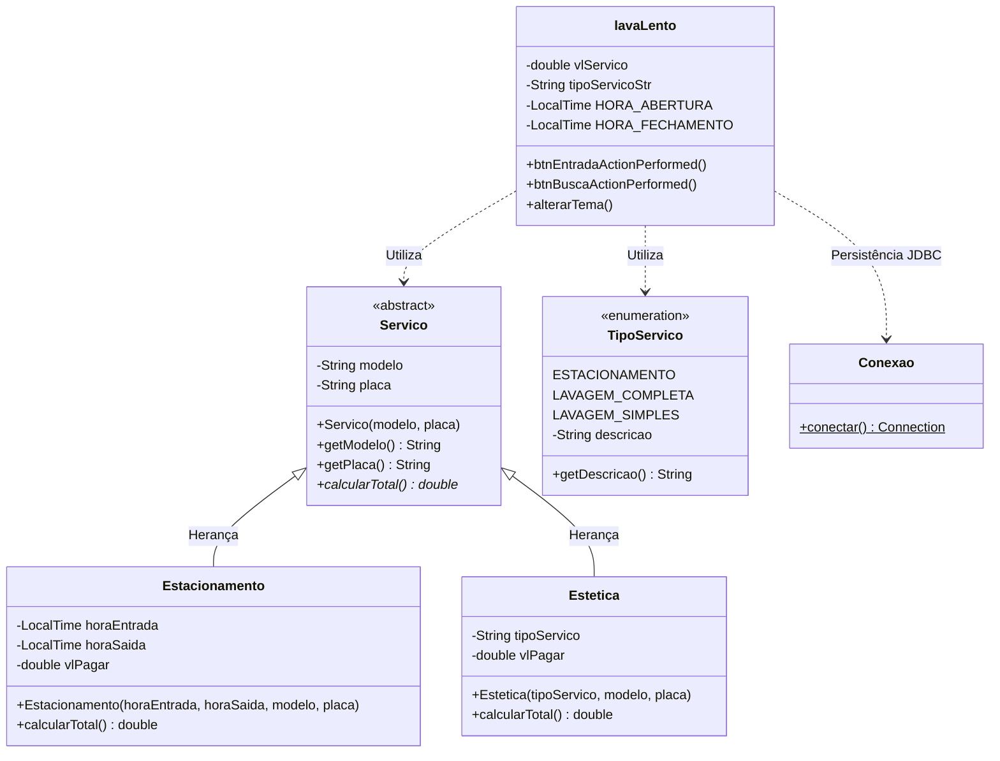

# 🚗 Lava Lento v2 — Sistema Simulador de Estacionamento & Estética Automotiva

[](https://www.oracle.com/java/)
[](https://maven.apache.org/)
[](https://www.mysql.com/)
[](https://www.formdev.com/flatlaf/)

O **Lava Lento v2** é um sistema desktop completo para controle e simulação operacional de fluxo de veículos em estacionamentos e centros de estética automotiva (lava-rápido). Desenvolvido em **Java**, o software oferece entrada e saída de veículos, tarifação horária dinâmica, pacotes de lavagem, alternância dinâmica de tema visual (Claro/Escuro) e persistência relacional com MySQL via JDBC.

---

## 🎯 Visão Geral da Arquitetura

O projeto foi estruturado seguindo os princípios de separação de responsabilidades, arquitetura orientada a objetos e integração com banco de dados relacional:



---

## 🏆 Competências Aplicadas do Curso de Programação Java

Este projeto consolida de forma prática os pilares fundamentais do aprendizado em desenvolvimento de software com a plataforma Java:

### 1. 🧠 Lógica de Programação e Algoritmos
- **Tipos Primitivos e Variáveis:** Utilização adequada de tipos escalares (`double`, `int`, `long`) para controle financeiro, temporizador e contadores de seleção.
- **Constantes e Imutabilidade:** Implementação de constantes com modificadores `private static final` para regras de negócio rígidas (ex.: horários fixos de funcionamento `HORA_ABERTURA = 07:00` e `HORA_FECHAMENTO = 18:00`).
- **Operadores Lógicos e Relacionais:** Aplicação de expressões booleanas compostas (`&&`, `||`, `!`) em validações críticas de horário operacional e bloqueio preventivo de campos vazios (`isBlank()`, `strip()`).
- **Lógica Temporal e Cálculo Matemático:** Uso das APIs do pacote `java.time` (`LocalTime`, `Duration`) combinado com funções matemáticas da classe `Math.ceil()` para tarifação proporcional por fração ou hora cheia.
- **Estruturas Condicionais e Controle de Fluxo:** Utilização de `if`, `else if` e seleções múltiplas para direcionamento do cálculo tarifário conforme o serviço selecionado.
- **Tratamento Robusto de Exceções:** Implementação de blocos `try-catch-finally` e `try-with-resources` para tratamento seguro de `SQLException` e `UnsupportedLookAndFeelException`, garantindo tolerância a falhas na interface e na conexão.

### 2. 🏛️ Programação Orientada a Objetos (POO)
- **Pacotes e Encapsulamento:** Estruturação em pacote canônico `com.mycompany.lavalentov2` com aplicação estrita de modificadores de visibilidade (`private`, `public`, `protected`) e métodos de acesso (Getters/Setters).
- **Abstração:** Criação da classe abstrata [`Servico`](file:///c:/Users/adm/Desktop/PROJETO%20X/lavaLentov2/src/main/java/com/mycompany/lavalentov2/Servico.java), servindo como molde canônico com contrato abstrato `public abstract double calcularTotal()`.
- **Herança e Polimorfismo:** Especialização de [`Servico`](file:///c:/Users/adm/Desktop/PROJETO%20X/lavaLentov2/src/main/java/com/mycompany/lavalentov2/Servico.java) nas classes concretas [`Estacionamento`](file:///c:/Users/adm/Desktop/PROJETO%20X/lavaLentov2/src/main/java/com/mycompany/lavalentov2/Estacionamento.java) e [`Estetica`](file:///c:/Users/adm/Desktop/PROJETO%20X/lavaLentov2/src/main/java/com/mycompany/lavalentov2/Estetica.java), cada uma sobrescrevendo `@Override` a regra de tarifação correspondente (regra horária versus tabela fixa de serviços).
- **Reutilização com `super()`:** Encadeamento de construtores nas subclasses para reaproveitamento consistente dos atributos comuns de veículo (`modelo`, `placa`).
- **Enumerações Avançadas:** Criação da enumeração [`TipoServico`](file:///c:/Users/adm/Desktop/PROJETO%20X/lavaLentov2/src/main/java/com/mycompany/lavalentov2/tipoServico.java) com estado interno e construtor (`ESTACIONAMENTO`, `LAVAGEM_COMPLETA`, `LAVAGEM_SIMPLES`), eliminando *magic strings* no código.
- **Empacotamento e Gerenciamento de Dependências:** Projeto estruturado via **Maven** (`pom.xml`), automatizando dependências do Driver MySQL e suíte de temas FlatLaf.

### 3. 🖥️ Interface Gráfica, APIs e Persistência JDBC
- **Componentes Gráficos Swing:** Construção rica em interface gráfica utilizando `JFrame`, `JTextField`, `JButton`, `JComboBox`, `JTextArea`, `JRadioButton` e diálogos modais de alerta com `JOptionPane`.
- **Design Moderno (FlatLaf):** Implementação de alternância de tema dinâmico em tempo de execução (*Light Mode* e *Dark Mode*) usando `FlatLightLaf`, `FlatDarkLaf` e `SwingUtilities.updateComponentTreeUI()`.
- **Event-Driven Programming:** Gerenciamento interativo de eventos (`ActionEvent`, `MouseEvent`) com reações contextuais, como desabilitar botões ao identificar campos não preenchidos.
- **Formatação de Dados e String Manipulation:** Utilização de `StringBuilder` para composição otimizada do cupom fiscal / ticket impresso no painel do operador, além de formatação monetária com `String.format("%.2f")`.
- **Persistência Relacional via JDBC:** 
  - Comunicação com MySQL através do `DriverManager.getConnection()`.
  - Execução de comandos DML (`INSERT`, `UPDATE`, `SELECT`) com **`PreparedStatement`**, assegurando parametrização contra SQL Injection.
  - Processamento de cursores e leitura de registros via **`ResultSet`**.
  - Gerenciamento eficiente e fechamento automático de cursores e conexões usando **`try-with-resources`**.

---

## 📁 Estrutura de Arquivos do Projeto

```text
lavaLentov2/
├── database/
│   └── schema.sql                                     # DDL para criação da base de dados e tabela
├── src/
│   ├── main/
│   │   └── java/
│   │       └── com/mycompany/lavalentov2/
│   │           ├── Conexao.java                       # Factory de conexão JDBC com segurança de credenciais
│   │           ├── Estacionamento.java                # Subclasse de tarifação temporal por hora
│   │           ├── Estetica.java                      # Subclasse de tarifação de lavagem simples/completa
│   │           ├── lavaLento.form                     # Definição do layout visual (NetBeans GUI Builder)
│   │           ├── lavaLento.java                     # Janela principal JFrame e controladores de eventos
│   │           ├── Servico.java                       # Classe base abstrata (Superclasse)
│   │           └── tipoServico.java                   # Enumeração tipada dos serviços disponíveis
│   └── test/
├── .gitignore                                         # Regras de exclusão do Git
├── pom.xml                                            # Gerenciamento de dependências Maven
└── README.md                                          # Documentação completa do projeto
```

---

## 🗄️ Banco de Dados

O projeto requer a tabela `registro` para persistência das operações. Você pode criá-la executando o script [`database/schema.sql`](file:///c:/Users/adm/Desktop/PROJETO%20X/lavaLentov2/database/schema.sql):

```sql
CREATE DATABASE IF NOT EXISTS lavalento CHARACTER SET utf8mb4 COLLATE utf8mb4_unicode_ci;
USE lavalento;

CREATE TABLE IF NOT EXISTS registro (
    id INT AUTO_INCREMENT PRIMARY KEY,
    placa VARCHAR(10) NOT NULL,
    modelo VARCHAR(50) NOT NULL,
    tipo_servico VARCHAR(50) NOT NULL,
    hora_entrada TIME,
    hora_saida TIME,
    valor_total DECIMAL(10, 2)
);
```

---

## 🔒 Segurança e Credenciais

Por boas práticas de engenharia de software e segurança:
- A senha do banco de dados **não** fica exposta no repositório.
- A classe [`Conexao.java`](file:///c:/Users/adm/Desktop/PROJETO%20X/lavaLentov2/src/main/java/com/mycompany/lavalentov2/Conexao.java) permite injetar a senha via variável de ambiente `DB_PASSWORD`, ou ajustando o placeholder localmente:

```bash
# Exemplo via PowerShell antes de iniciar
$env:DB_PASSWORD="sua_senha_aqui"
```

---

## 🚀 Como Executar o Projeto

### Pré-requisitos
- **Java JDK 21 ou 25** instalado
- **Maven 3.8+** instalado
- **Servidor MySQL** em execução na porta `3306`

### Passo a Passo

1. **Clone o repositório:**
   ```bash
   git clone https://github.com/Maria-Perrone/lavalento-simulador-estacionamento.git
   cd lavalento-simulador-estacionamento
   ```

2. **Crie a base de dados no MySQL:**
   ```bash
   mysql -u root -p < database/schema.sql
   ```

3. **Compile e empacote com Maven:**
   ```bash
   mvn clean package
   ```

4. **Execute a aplicação:**
   ```bash
   mvn exec:java -Dexec.mainClass="com.mycompany.lavalentov2.lavaLento"
   ```

---

## 👩‍💻 Autora

**Maria Perrone**
- GitHub: [@Maria-Perrone](https://github.com/Maria-Perrone)
- E-mail: Perronem808@gmail.com
- Projeto acadêmico desenvolvido no curso de Análise e Desenvolvimento de Sistemas / Programação Java.
